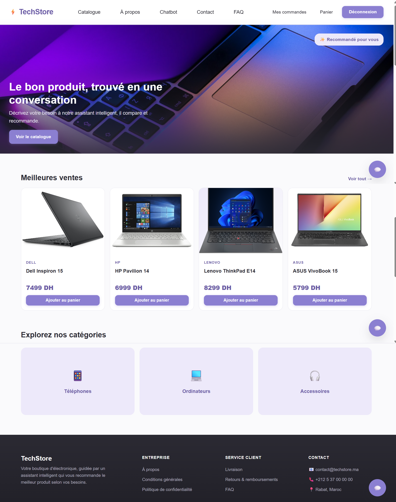
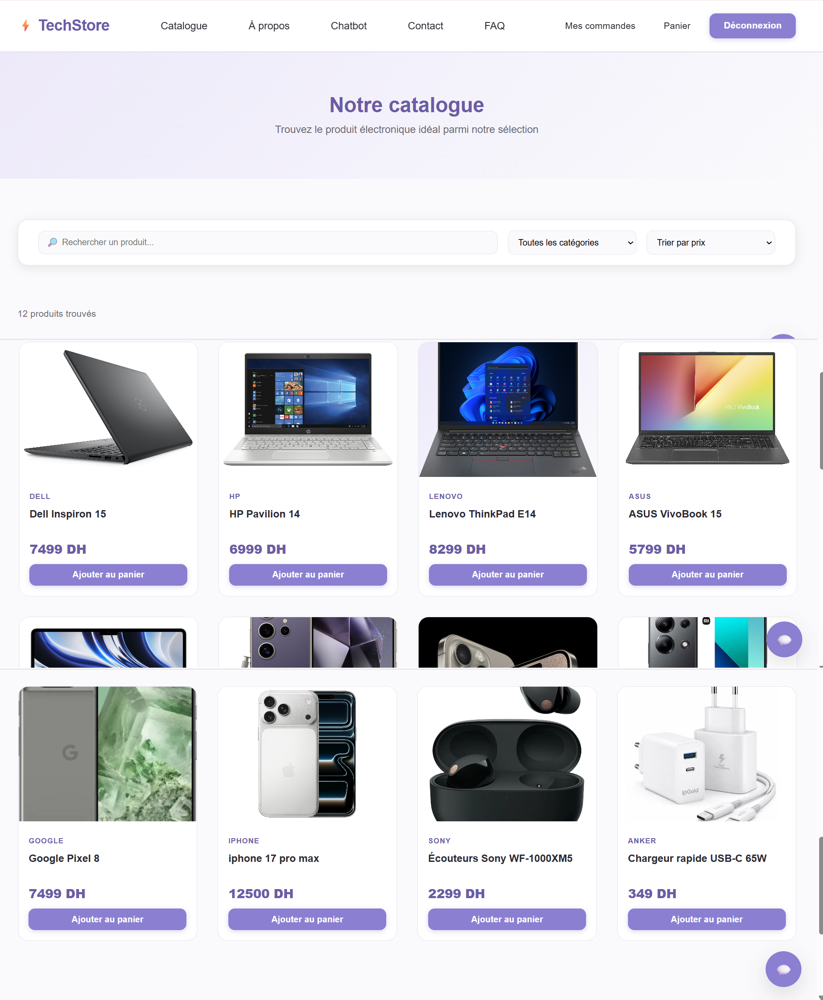
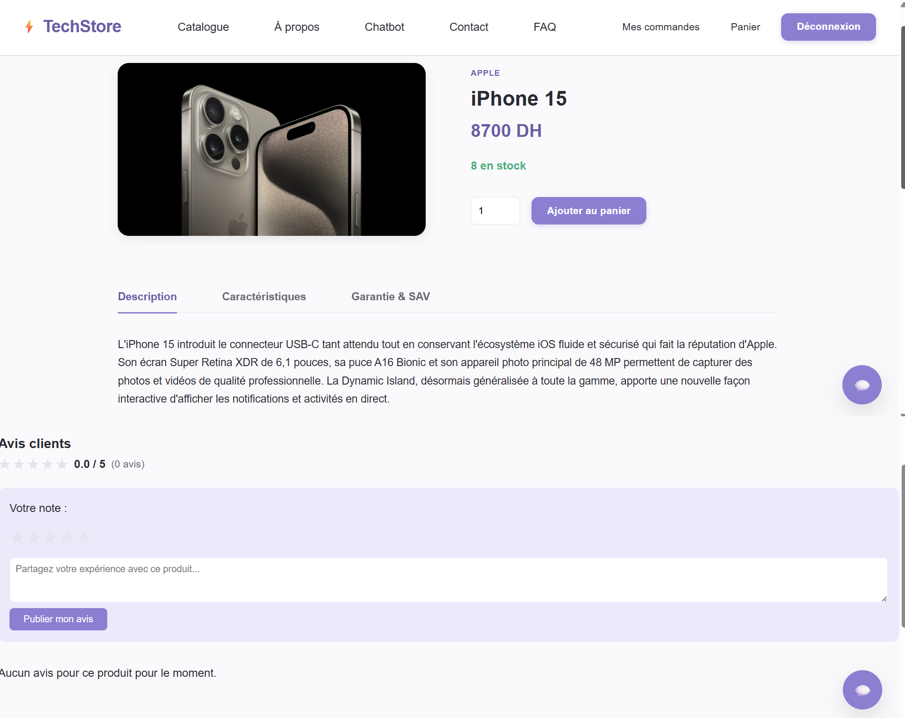
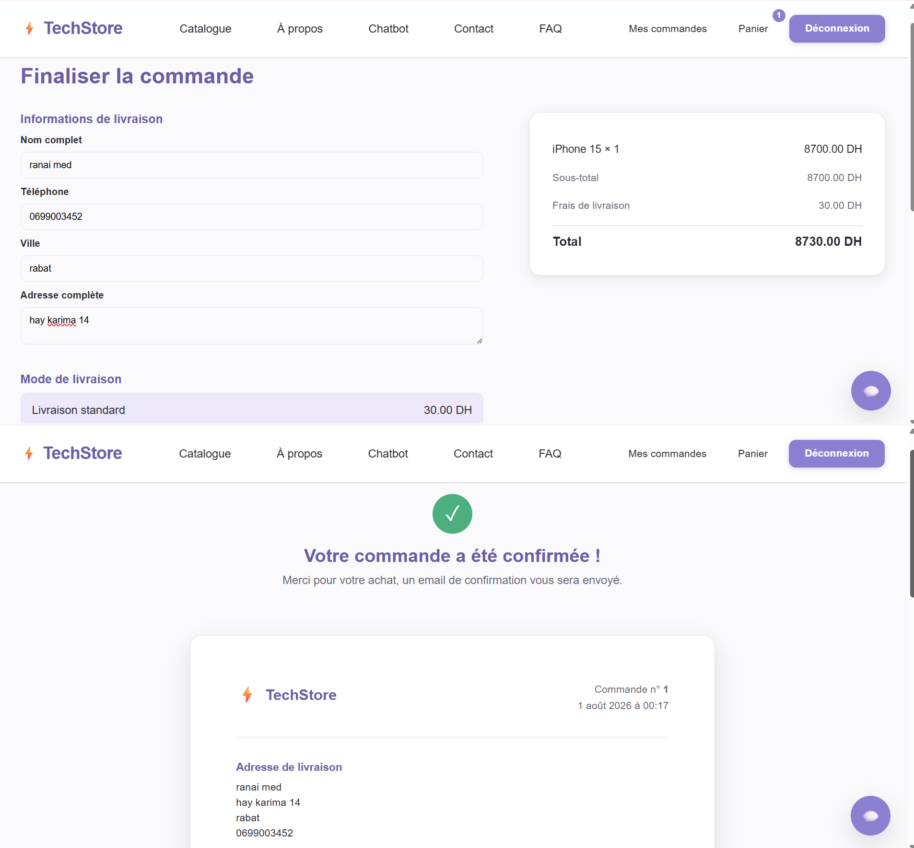
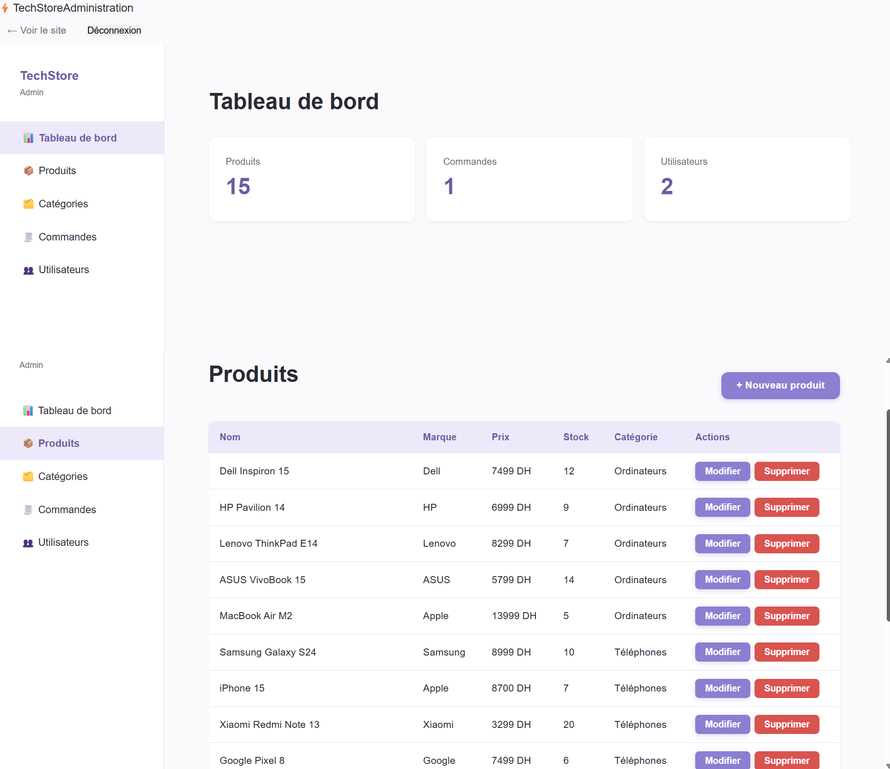

# TechStore : plateforme e-commerce avec chatbot IA

Plateforme e-commerce full-stack intégrant un chatbot intelligent d'aide au choix de produit, développée lors de mon stage chez OmniConsulting (juillet - août 2026, pôle AI Retail).

## Le problème
Sur une boutique en ligne classique, le client doit filtrer et comparer lui-même les produits. Le chatbot permet à un client de décrire son besoin en langage naturel et de recevoir une recommandation adaptée, avec une courte justification.

## Technologies
- **Backend :** Java 21, Spring Boot, Spring Security, JWT, Spring Data JPA / Hibernate, API REST
- **Frontend :** React (Vite), React Router, Axios, Context API
- **Base de données :** MySQL
- **IA :** API Google Gemini
- **Méthode :** Agile (inspirée de Scrum), 6 cycles de développement

## Architecture
Architecture 3 tiers : application React (SPA), API REST Spring Boot sécurisée par JWT, base MySQL. Le module chatbot appelle l'API Gemini depuis le backend.

## Fonctionnalités
**Client**
- Inscription, connexion et gestion du profil
- Catalogue avec recherche, filtres (catégorie, marque, prix, disponibilité) et tri
- Fiche produit détaillée avec avis et notes (1 à 5 étoiles)
- Panier, formulaire de livraison, confirmation et suivi du statut des commandes
- Chatbot de recommandation de produits

**Administrateur**
- Tableau de bord (produits, commandes, utilisateurs)
- Gestion des produits, des catégories, des commandes (changement de statut) et des utilisateurs
- Génération de facture PDF par commande

## Le chatbot
Chaque message est traité de façon autonome : le système détecte le besoin (type de produit, budget, mots-clés élargis par une table de synonymes), recherche les produits correspondants dans le catalogue, puis demande à Gemini de recommander le plus adapté. La réponse est ancrée dans le catalogue réel pour limiter les hallucinations, avec reprise automatique en cas de surcharge de l'API.

## Sécurité
- Authentification stateless par JWT et mots de passe hachés avec BCrypt
- Contrôle d'accès par rôle (public, client, administrateur)
- Rôle attribué côté serveur uniquement
- Montant des commandes et stock recalculés et vérifiés côté serveur

## Captures d'écran
### Page d'accueil

### Catalogue

### Chatbot de recommandation

### Fiche produit et avis clients

### Commande et confirmation

### Administration

## Auteure
Oumaima Mendil, élève ingénieure en génie informatique (EMSI Rabat)
[LinkedIn](linkedin.com/in/oumaima-mendil)

## Auteure
Oumaima Mendil, élève ingénieure en génie informatique (EMSI Rabat)
[LinkedIn](https://www.linkedin.com/in/oumaima-mendil-051969339)
